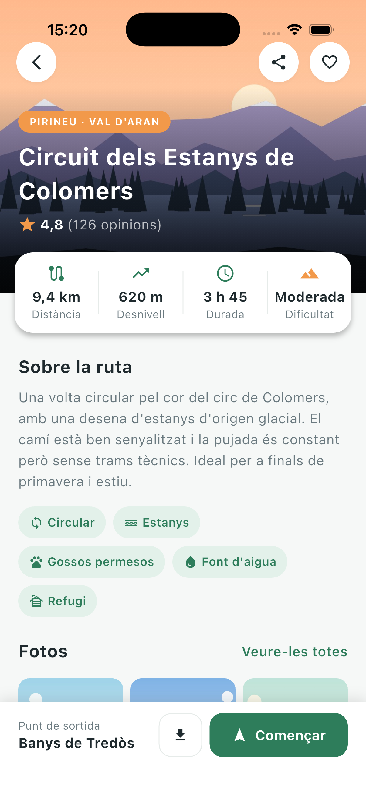
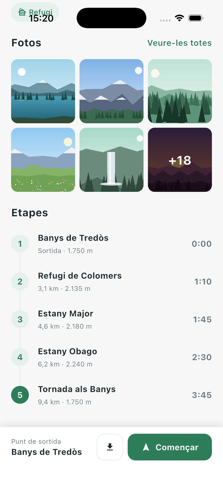

# Camins · Activitat d'avaluació 1.3 — De disseny a pantalla

Implementación en **Flutter** de la pantalla de detalle de una ruta de montaña («Circuit dels Estanys de Colomers») a partir del diseño proporcionado por la diseñadora.

**Nivel alcanzado:** Base ✅ · Ampliació ✅ · Repte ✅

## Capturas

| Inicio de la pantalla | Final (haciendo scroll) |
|:---:|:---:|
|  |  |

> Capturas hechas en el simulador de iPhone 17. La barra inferior se mantiene fija mientras se hace scroll.

## Qué incluye cada nivel

### Base
| Zona | Implementación |
|---|---|
| 2 · Título | `Stack` con la imagen (`Image.asset`, `BoxFit.cover`), un degradado `transparent → black87` y el texto con `Positioned` |
| 3 · Ficha de datos | `Card` + `SizedBox(height: 88)` + `Row` con cuatro `Expanded`, cada uno con un `StatItem` |
| 4 · Sobre la ruta | Texto + etiquetas en un `Wrap`, que salta de línea solo cuando no caben |
| 7 · Barra inferior | `bottomNavigationBar` del `Scaffold`, con `OutlinedButton` y `FilledButton.icon` |

### Ampliació
| Zona | Implementación |
|---|---|
| 5 · Fotos | `GridView.count` de 3 columnas con `shrinkWrap` y `NeverScrollableScrollPhysics`; cada foto dentro de un `ClipRRect` |
| 6 · Etapas | Lista generada con un bucle a partir de un modelo `TrailStage` |

### Repte
- **Tres botones redondos** sobre la imagen (`CircleIconButton`, 44×44).
- **La ficha de datos sobresale 44 px** de la imagen: cabecera y ficha comparten un `Stack` de 320 + 44 de alto, y el texto de la cabecera sube 44 px (`bottomInset`) para no quedar tapado.
- **Última foto oscurecida con «+18»** (`PhotoTile` con una capa `black54` y el texto centrado).
- **Línea vertical que une las etapas**: cada fila dibuja su tramo de línea detrás del círculo; la primera solo hacia abajo y la última solo hacia arriba.

## Estructura del código

```
lib/
├── main.dart
├── models/
│   ├── trail_stage.dart
│   └── trail_tag.dart
├── screens/
│   └── trail_detail_screen.dart
├── styles/
│   └── app_styles.dart          ← colores, espacios, medidas y estilos de texto
└── widgets/
    ├── about_section.dart
    ├── bottom_action_bar.dart
    ├── circle_icon_button.dart
    ├── photo_grid.dart
    ├── photo_tile.dart
    ├── section_header.dart
    ├── stage_tile.dart
    ├── stages_section.dart
    ├── stat_item.dart           ← widget propio obligatorio
    ├── stats_card.dart
    ├── tag_chip.dart            ← widget propio obligatorio
    └── trail_header.dart
```

**Buenas prácticas aplicadas**
- Una clase por fichero; en la raíz de `lib` solo está `main.dart`.
- Todos los colores, espacios y medidas salen de `AppStyles`; no hay valores escritos a mano en los widgets.
- Nombres de código en inglés; textos de pantalla en catalán.
- Widgets con parámetros y reutilizados: `StatItem` ×4, `TagChip` ×5, `SectionHeader` ×3, `CircleIconButton` ×3.
- Los datos (etiquetas, fotos, etapas) se pasan como listas y se pintan con bucles, sin copiar bloques.
- `flutter analyze`: sin errores ni avisos.

## Cómo ejecutarlo

```bash
flutter pub get
flutter run
```

## Reflexión

**Cómo me puse.** Primero leí el enunciado y estudié el diseño y la hoja de especificaciones, y apunté todas las medidas (alturas, radios, márgenes, tamaños de letra). Después fui zona por zona y de arriba abajo, como recomienda el enunciado: primero que todo estuviera, luego ajustar medidas y colores. Antes de escribir cada zona pensaba qué cosas están *una encima de otra* (`Stack`), *una debajo de otra* (`Column`) o *una al lado de otra* (`Row`), y eso me daba casi directamente el árbol de widgets. Hice un commit al terminar cada zona.

**Qué salió bien.** Separar cada parte en su propio widget con parámetros hizo que la pantalla principal quedara muy limpia: solo coloca las zonas en orden y les pasa los datos. Tener todas las medidas en `AppStyles` también facilitó ajustar el diseño desde un solo sitio.

**Qué me costó.** Lo que más tiempo me llevó no fue el código, sino el entorno: el terminal de VS Code no tenía permiso de macOS para acceder a la carpeta Documentos, el plugin de Flutter no estaba instalado, la organización del proyecto (`cat.cifovirtual`) no se pide al crear el proyecto desde VS Code, y el simulador de iOS tardaba tanto en arrancar la primera vez que VS Code daba error de tiempo de espera. En el código, lo más difícil fue que la ficha de datos sobresaliera de la imagen sin descuadrar el resto de la página.

**Qué me sorprendió.** Un error con la línea de las etapas: no se veía porque una `Row` da a sus hijos una altura «flexible», así que el `Stack` que contenía la línea solo medía lo que el círculo, y la línea quedaba escondida detrás. Al darle la altura de la fila (68) apareció. Fue la primera vez que entendí de verdad la frase «las restricciones bajan y los tamaños suben». También me sorprendió que en el iPhone 17 (402 de ancho) las etiquetas ocupen tres líneas en vez de dos como en el diseño (412 de ancho): es justo el comportamiento que se pide al usar `Wrap`.

**Qué he aprendido.**
- A traducir un diseño a widgets: `Stack` + `Positioned`, `Expanded` para repartir espacio, `Wrap` para contenido que debe saltar de línea, `mainAxisSize.min` para que una `Row` no ocupe todo el ancho.
- Que una lista o una cuadrícula dentro de un `ListView` necesita `shrinkWrap` y `NeverScrollableScrollPhysics`.
- Que `ListTile` es cómodo, pero cuando necesitas dibujar algo propio (como la línea) es mejor construir la fila a mano.
- Que el truco para solapar elementos es reservar el espacio real en el layout, no solo moverlos visualmente.

**Qué cambiaría.** Prepararía el entorno (permisos, plugins, simulador) antes de empezar, para no perder tiempo. Probaría desde el principio en un emulador Android «Medium Phone», que tiene exactamente las medidas del diseño (412 × 915). Y para el Repte de la ficha solapada, pensaría el layout de cabecera + ficha juntos desde el principio, en vez de tener que reestructurarlo al final.
